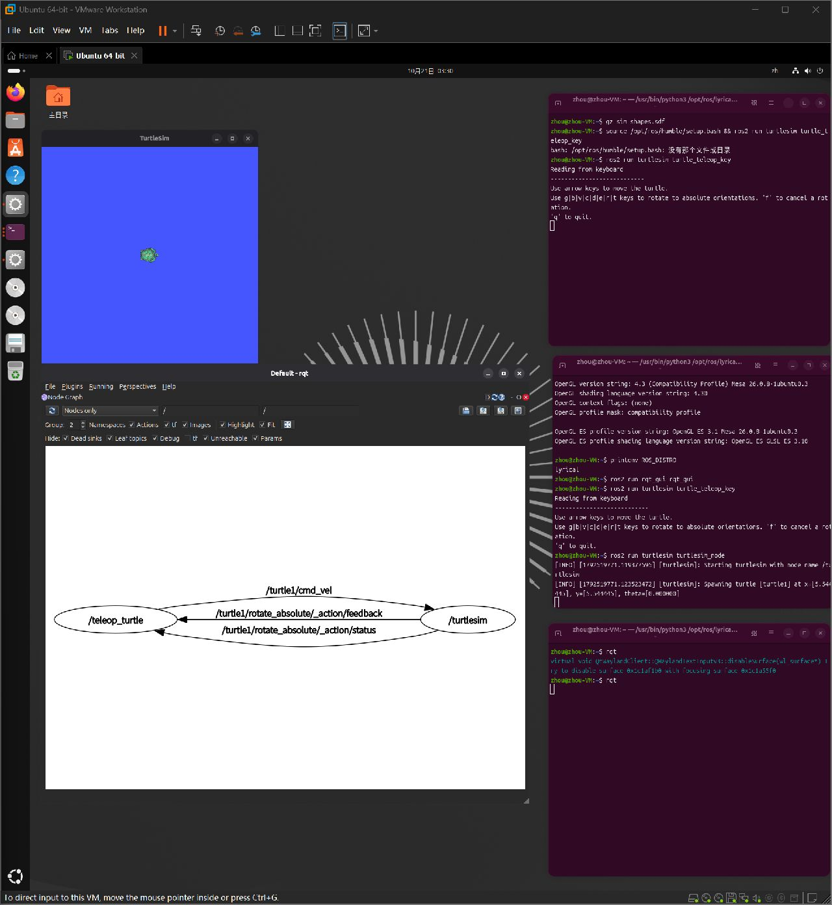

# CHAPT1：Ubuntu 与小海龟实验记录

[本章入口](README.md) · [小海龟实验步骤](TURTLESIM.md) · [本章排错](TROUBLESHOOTING.md)

本页保存本章的环境与界面证据，按实验内容归档。后续 Python 功能包的运行与排错材料见 [CHAPT2](../CHAPT2/README.md)。

## 本次目标

跟随鱼香 ROS 机器人《ROS 2机器人开发从入门到实践》[1.3 运行你的第一个机器人](https://www.bilibili.com/video/BV1iE421w7d5/)，在现有 Ubuntu 环境中认识 TurtleSim、节点与话题，建立 GitHub 记录。

## 环境与证据来源

| 项目 | 当前信息 | 来源 |
| --- | --- | --- |
| 运行方式 | VMware Ubuntu 虚拟机 | 本次直接查看窗口 |
| Ubuntu | 26.04.1 LTS，x86_64 | 仓库此前用户报告；本次未重新执行系统版本检查 |
| ROS 2 | Lyrical，`ROS_DISTRO=lyrical` | 画面中 `printenv ROS_DISTRO` 的实际输出 |
| 学习基础 | 已有 C++ / Linux 基础 | 本次学习者选择 |
| 课程 | 鱼香 ROS 机器人，1.3 运行你的第一个机器人 | 本次读取用户提供的视频页面标题与课程说明 |

## 已观察并截图记录

- TurtleSim 窗口已经显示海龟。
- 键盘控制程序的终端显示 `Reading from keyboard`。
- rqt 节点图显示 `/teleop_turtle` 与 `/turtlesim`，通过 `/turtle1/cmd_vel` 连接。
- 图中还显示 Action 的反馈和状态连接，本课暂不据此验收 Action 学习。
- 已创建本节笔记、后续路线与章节记录模板，保存在同一仓库中。

### Ubuntu 学习现场



原始 VMware 窗口截图，保留 Ubuntu 桌面与终端上下文。截图能证明这些程序和节点图当时已显示，不能单凭静态截图证明键盘控制、消息值、帧率或整个仿真系统正常。

### 小海龟与节点图局部


局部图裁自同次学习观察，便于阅读节点与话题名称。

## 发现的版本问题

终端历史中可见：

```bash
source /opt/ros/humble/setup.bash
```

该路径报“没有那个文件或目录”。同一画面中 `printenv ROS_DISTRO` 的结果为 `lyrical`，说明当前终端加载的发行版是 Lyrical。后续按实际环境检查并加载：

```bash
source /opt/ros/lyrical/setup.bash
```

这条修正后的命令是后续复现步骤，本次未额外执行并采集其退出结果。错误反映了 Humble 路径与当前环境不对应，不据此判断 ROS 2 需要重装。

## 接下来由自己执行并补充

参照 [本章小海龟实验](TURTLESIM.md)，在新 Ubuntu 终端记录：

```bash
cat /etc/os-release
source /opt/ros/lyrical/setup.bash
printenv ROS_DISTRO
ros2 node list
ros2 topic list -t
ros2 topic info /turtle1/cmd_vel
ros2 topic echo /turtle1/cmd_vel
```

然后将焦点切回键盘控制终端按方向键，对照海龟运动和 `linear.x`、`angular.z` 的变化。

- [x] 确认当前画面显示 Lyrical、TurtleSim 和节点图。
- [x] 保存 Ubuntu 截图和本节学习资料。
- [ ] 保存上面命令的实际输出。
- [ ] 验证方向键能控制海龟运动。
- [ ] 保存一组速度消息，说明哪个节点发布、哪个节点订阅。
- [ ] 用自己的话区分包、可执行程序、节点、话题与消息类型。

## 我的理解

待学习者填写：`/teleop_turtle`、`/turtlesim`、`/turtle1/cmd_vel` 分别是什么，它们如何合作？

## 下一步

补充本章运动与实际消息记录，并继续 [CHAPT2：C++ / Python 节点与功能包](../CHAPT2/README.md)。第二章的 Python 与 C++ 包均已有构建、运行成功证据；后续同步新 C++ 包源码并学习通信。
