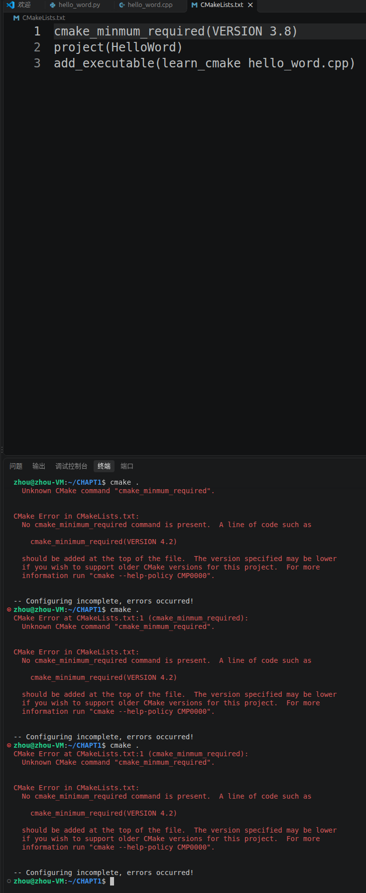
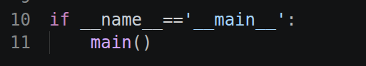

# 第一章排错记录

[本章入口](README.md) · [小海龟实验](TURTLESIM.md) · [环境与截图](EVIDENCE.md)

## CMake 不认识 `cmake_minmum_required`

**现象：** 执行 `cmake .`，提示 `Unknown CMake command "cmake_minmum_required"`，同时报告没有 `cmake_minimum_required`。



**原因：** 第一行命令的 `minimum` 少了字母 `i`。报错中展示的 `VERSION 4.2` 是提示示例，不能据此认定必须改为 4.2。

**修正：** 当前上传的 [CMakeLists.txt](CMakeLists.txt) 已是：

```cmake
cmake_minimum_required(VERSION 3.8)
project(HelloWord)
add_executable(learn_cmake hello_word.cpp)
```

保存后，在 `CHAPT1` 中使用独立构建目录：

```bash
cmake -S . -B build/cmake
cmake --build build/cmake
./build/cmake/learn_cmake
```

源码对应预期输出 `hello word`。本次保留的是错误现场和已修正配置，尚无该 C++ 示例重新构建运行成功的截图。

## 加载了其他 ROS 2 发行版的路径

**现象：** `source /opt/ros/humble/setup.bash` 提示没有文件；同一 Ubuntu 画面中 `printenv ROS_DISTRO` 输出 `lyrical`。

**处理：** 使用当前安装对应的路径 `source /opt/ros/lyrical/setup.bash`。新终端也需要加载环境。原始现场和证据边界见 [EVIDENCE.md](EVIDENCE.md#发现的版本问题)。

## Python 的 `__main__` 判断是什么意思

```python
if __name__ == '__main__':
    main()
```

直接运行该文件时，`__name__` 为 `'__main__'`，因而调用 `main()`；被其他文件导入时，不执行这里的调用。它不会自动创建 `main` 函数，函数应先定义。



实际带入口判断的代码在[第二章独立 Python 节点](../CHAPT2/ros2_python_node.py)；第一章 `hello_word.py` 是直接打印的最小示例。

## 记录原则

错误截图反映当时的状态，仓库源码保留目前的修正版。生成的 `CMakeFiles/`、缓存、Makefile 和可执行文件不作为源码上传，避免携带 Ubuntu 本机绝对路径。原始学习文件保持不变。
