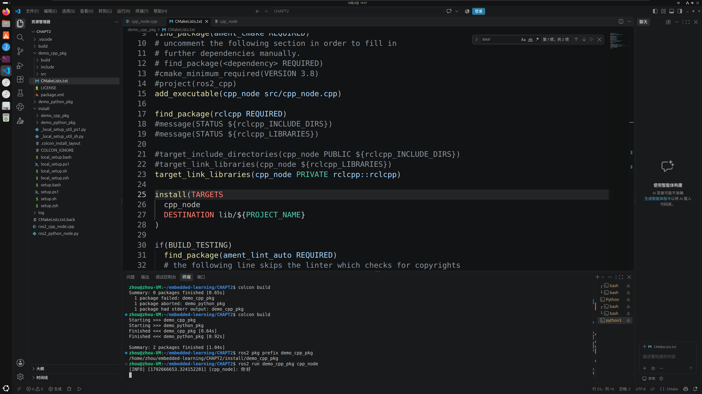
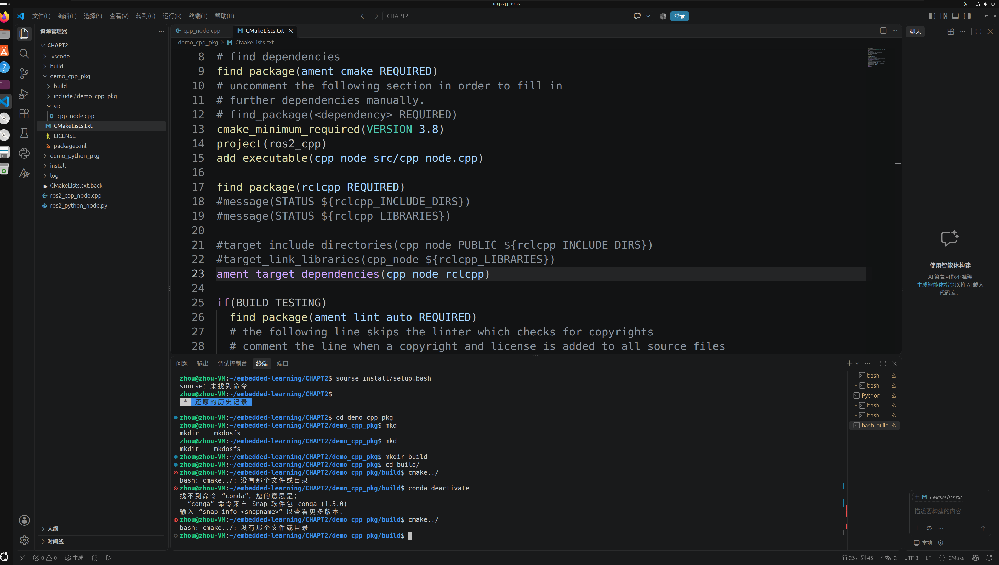
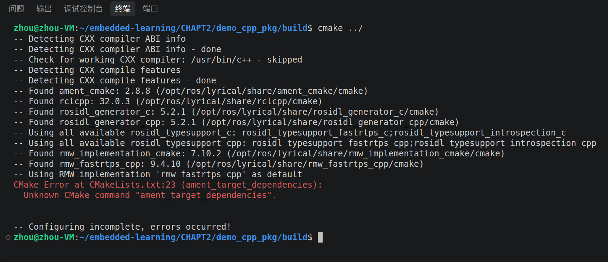
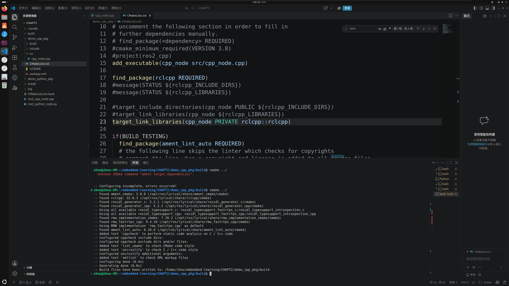
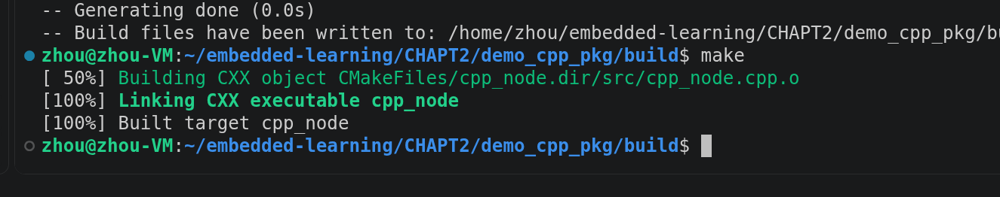
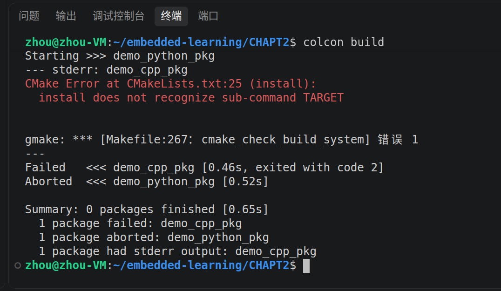

# 第二章：C++ 功能包构建、安装与运行

[本章入口](README.md) · [Python 包排错](TROUBLESHOOTING.md) · [学习进度](../docs/progress.md)

## 已验证的结果

学习者在 Ubuntu + ROS 2 Lyrical 中完成了 `demo_cpp_pkg` 的 CMake 配置、编译、colcon 构建和节点启动。最终截图显示：

```text
Finished <<< demo_cpp_pkg
Finished <<< demo_python_pkg
Summary: 2 packages finished

ros2 pkg prefix demo_cpp_pkg
/home/zhou/embedded-learning/CHAPT2/install/demo_cpp_pkg

ros2 run demo_cpp_pkg cpp_node
[INFO] [...] [cpp_node]: 你好
```



这次证据覆盖构建、安装前缀、包发现与日志输出。发布/订阅和机器人控制仍留待后续实验。

## 源码归档状态

本仓库已有早期独立示例 [ros2_cpp_node.cpp](ros2_cpp_node.cpp) 和 [CMakeLists.txt.back](CMakeLists.txt.back)。本次运行的 `demo_cpp_pkg/src/cpp_node.cpp`、完整 `CMakeLists.txt` 与 `package.xml` 尚未同步到学习者此前提供的源码归档目录，因此这里保留实际截图、命令及关键配置，不将早期独立示例视为本次新包的完整源码副本。

以下工作空间命令用于学习者 Ubuntu 中已有的 `demo_cpp_pkg`；从 GitHub 新克隆仓库时，还需要补齐该包完整源码才能复现 C++ 包构建。

## 排错过程

### 1. `cmake../` 少了空格

起初在包内的 `build` 目录输入 `cmake../`，Bash 报没有文件或目录。命令和参数需要分开：

```bash
cmake ..
```

`cmake` 是命令，`..` 表示上一级源码目录。图中还出现历史命令 `sourse install/setup.bash`，应拼作 `source`；这条错误位于终端历史，无需在 CMake 文件里搜索修改。



截图中还曾在包模板中额外加入 `cmake_minimum_required(...)` 和 `project(ros2_cpp)`。后续将这两行注释，沿用模板开头的声明。项目名应与 `package.xml` 的包名一致，本次功能包名为 `demo_cpp_pkg`。

### 2. Lyrical 不再提供旧的依赖宏

加上空格后，配置找到了：

```text
ament_cmake: 2.8.8
rclcpp: 32.0.3
```

随后在第 23 行报错：

```text
Unknown CMake command "ament_target_dependencies".
```



旧教程使用：

```cmake
ament_target_dependencies(cpp_node rclcpp)
```

本次改为现代 CMake 目标链接：

```cmake
find_package(ament_cmake REQUIRED)
find_package(rclcpp REQUIRED)

add_executable(cpp_node src/cpp_node.cpp)
target_link_libraries(cpp_node PRIVATE rclcpp::rclcpp)
```

`rclcpp::rclcpp` 是 rclcpp 导出的 CMake 目标，提供头文件目录、编译与链接所需信息。旧的宏已在 Lyrical 使用的版本中移除，可参考 [ament 官方变更](https://github.com/ament/ament_cmake/pull/614)与 [ROS 2 Lyrical 官方示例](https://github.com/ros2/examples/blob/lyrical/rclcpp/topics/minimal_publisher/CMakeLists.txt)。

保存后重新配置，终端显示 `Configuring done`、`Generating done` 和构建目录路径：



### 3. 区分配置成功与编译成功

上述配置成功后，在同一个包内 `build` 目录执行了 `make`：

```text
[ 50%] Building CXX object .../src/cpp_node.cpp.o
[100%] Linking CXX executable cpp_node
[100%] Built target cpp_node
```



配置阶段生成构建文件，编译阶段才生成可执行程序。也可使用 `cmake --build .` 调用当前构建目录对应的构建工具。手动构建成功后，继续完善 ROS 2 功能包的安装步骤。

### 4. `install` 应使用 `TARGETS`

回到 `CHAPT2` 执行 `colcon build` 时，新增安装段出现：

```text
CMake Error at CMakeLists.txt:25 (install):
  install does not recognize sub-command TARGET
```



关键字应为复数 `TARGETS`，修正片段为：

```cmake
install(TARGETS cpp_node
  DESTINATION lib/${PROJECT_NAME}
)
```

功能包的文件末尾保留 `ament_package()`。`lib/${PROJECT_NAME}` 将可执行程序安装到包对应的目录，供 `ros2 run` 查找。这里展示的是关键配置片段，完整源文件仍待归档。

同次构建中的 Python 包显示 `Aborted`；该画面明确报告的配置错误来自 C++ 包。修正后再次构建，两个包均完成。

## 最终构建与运行流程

在包含两个功能包的工作空间根目录执行：

```bash
cd ~/embedded-learning/CHAPT2
source /opt/ros/lyrical/setup.bash
colcon build
source install/setup.bash
ros2 pkg prefix demo_cpp_pkg
ros2 run demo_cpp_pkg cpp_node
```

最终截图直接展示了 `colcon build`、两个包完成、包前缀和 `ros2 run` 的日志结果。上面的环境加载命令作为完整操作流程保留；该截图没有展开每条环境加载命令的执行历史。

后续只重新构建 C++ 包时，可用 `colcon build --packages-select demo_cpp_pkg`。新终端需要重新加载 ROS 2 与工作空间环境。节点运行后可在另一个已加载相同环境的终端中执行 `ros2 node list` 检查节点；当前尚未归档该命令的实际输出。

## 本轮结论与下一步

- 命令拼写错误：区分 `cmake ..` 与 `cmake../`，`source` 与 `sourse`。
- 版本差异：Lyrical 使用 `target_link_libraries(... rclcpp::rclcpp)` 替代旧宏。
- 安装配置：`install(TARGETS ...)` 使用复数关键字，并指定包对应的安装目录。
- 验收顺序：配置 → 编译 → 工作空间构建与安装 → 包发现 → 节点运行，分别保留证据。

下一步补齐新 C++ 包的完整源码归档，并开始发布者与订阅者实验。当前成功结果为日志节点启动，不扩展为通信、机械臂或模型推理成果。
