# 第二章：PersonNode、WriterNode 与继承排错

[本章入口](README.md) · [Python 包排错](TROUBLESHOOTING.md) · [C++ 实验](CPP_NODE.md)

本节记录从普通 Python 类入口运行，到继承 ROS 2 Node，再到日志组合的过程。旧错误截图、成功截图与当前源码分别保留。当前源码见 [PersonNode](chapt2_ws/src/demo_python_pkg/demo_python_pkg/person_node.py)、[WriterNode](chapt2_ws/src/demo_python_pkg/demo_python_pkg/writer_node.py)和 [入口配置](chapt2_ws/src/demo_python_pkg/setup.py)。

## 1. 构建通过，但 person_node 模块不存在

报错为 `ModuleNotFoundError: No module named 'demo_python_pkg.person_node'`。先在包目录构建，随后回到工作空间构建仍然报错。通过 find 和实际导入路径检查，确认源码还在外层 `src/demo_python_pkg/person_node.py`；安装目录只有入口脚本，没有实际模块。

修正位置是内层 `src/demo_python_pkg/demo_python_pkg/person_node.py`，与 `__init__.py` 同级。入口字符串 `person_node = demo_python_pkg.person_node:main` 对应的也是内层模块。移动文件、从工作空间根目录重新构建并加载环境后，普通类示例连续两次输出人物信息。

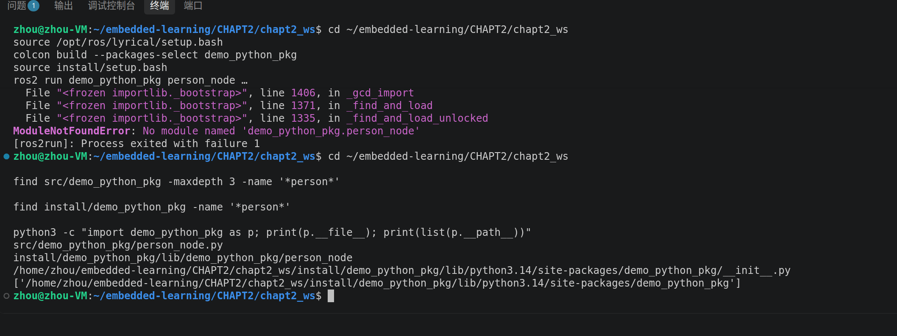

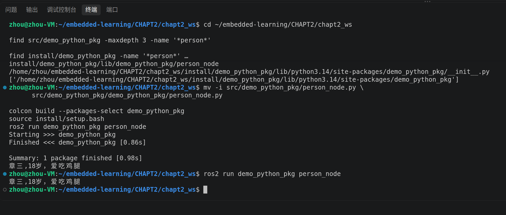

<details>
<summary>查看最初导入失败与切换工作空间后的报错</summary>

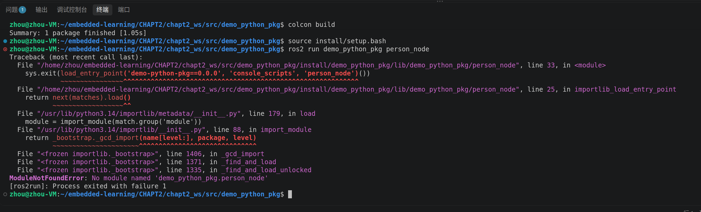

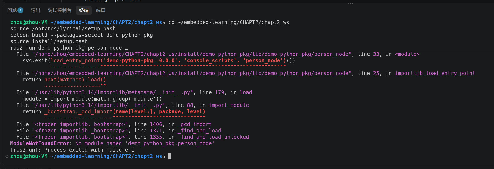

</details>

## 2. WriterNode 没有 name 属性

WriterNode 调用继承的 eat 后报 `AttributeError: 'WriterNode' object has no attribute 'name'`。PersonNode 的初始化负责设置 name 和 age，子类重写构造函数后，需要针对当前对象调用父类初始化：

```python
super().__init__(node_name, name, age)
self.book = book
```

早期纯 Python 版本只传 name、age；后来 PersonNode 继承 Node，新增 node_name 参数，调用处也同步扩展。不能把不同阶段的参数列表混用。直接创建另一个 PersonNode 对象，不等于初始化当前 WriterNode。最初子类完整错误源码未留存，因此不臆造它当时采用的具体写法。

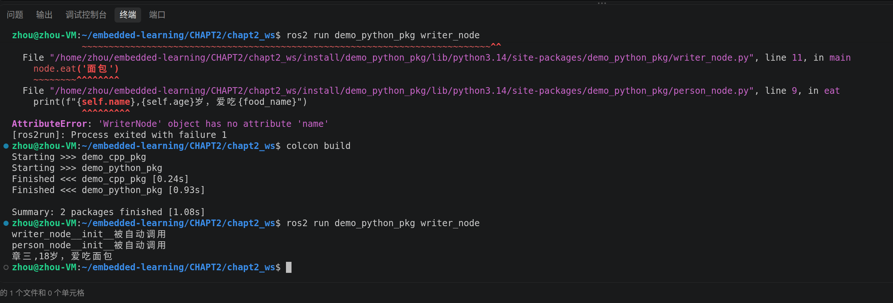

<details>
<summary>查看属性缺失现场</summary>

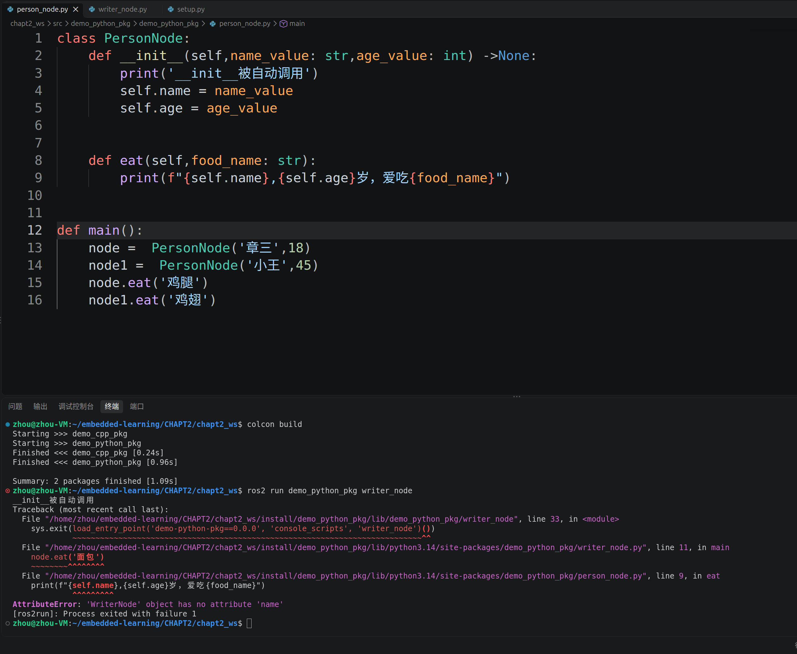

</details>

## 3. 从普通 Python 类到 ROS 2 节点

PersonNode 改为继承 `rclpy.node.Node` 后，创建对象前必须调用 `rclpy.init()`。遗漏时出现 `NotInitializedException: rclpy.init() has not been called`；补充后成功输出带节点名的 INFO 日志并进入 spin。

```text
rclpy.init() → 创建 PersonNode → eat 输出日志 → rclpy.spin(node)
```

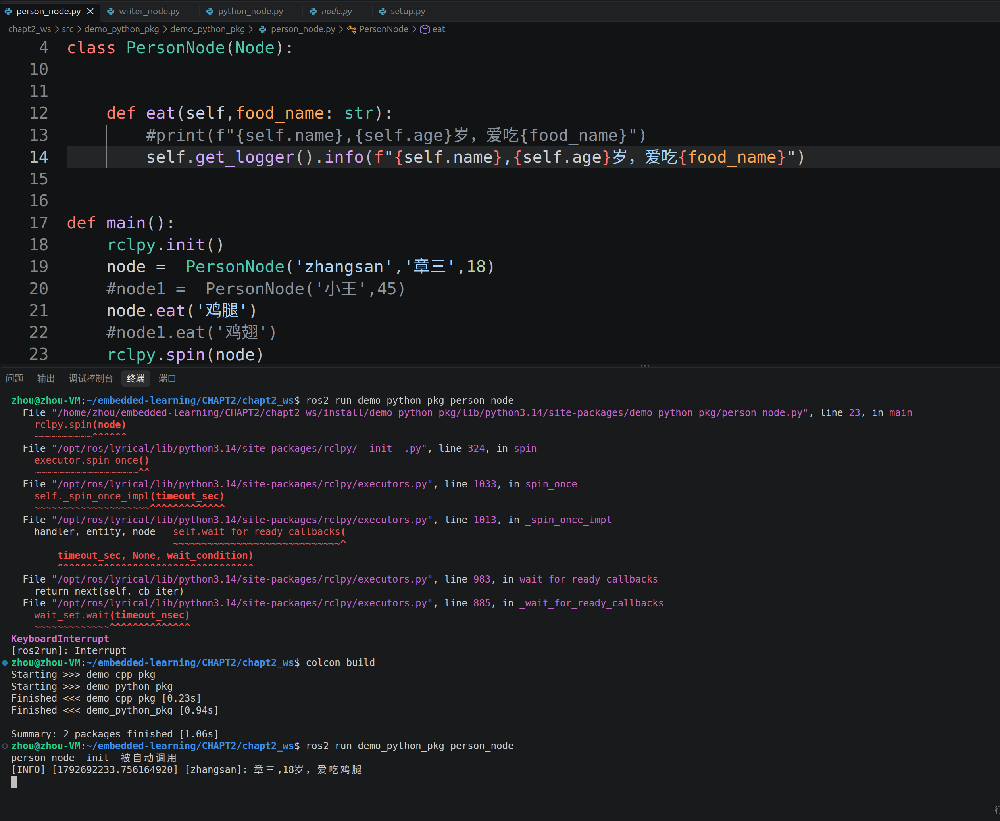

<details>
<summary>查看遗漏 rclpy.init 的报错</summary>

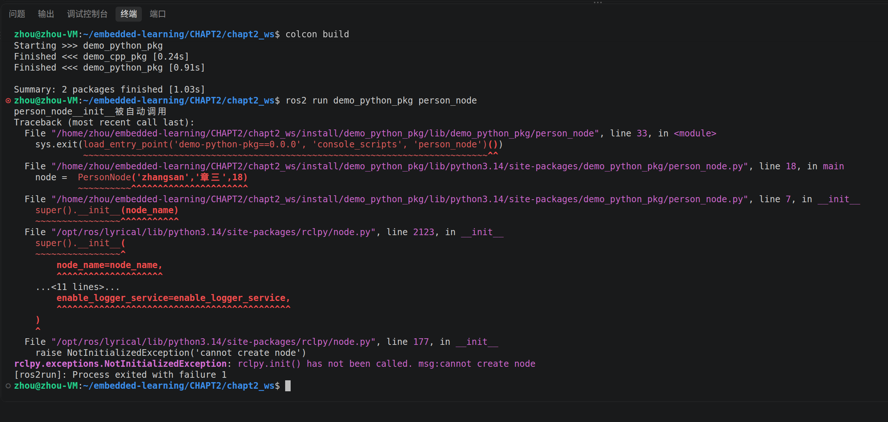

</details>

前面的普通类输出只能验证 Python 入口，后面的 Node 继承和节点日志才是 ROS 2 节点阶段。当前尚无发布/订阅或机械臂实验。

## 4. Ctrl+C 后的 KeyboardInterrupt

节点在 spin 中等待时收到 Ctrl+C，会产生 KeyboardInterrupt。未捕获异常时显示堆栈，返回命令提示符后进程已经结束，不能把这段手动退出记录当成启动失败。

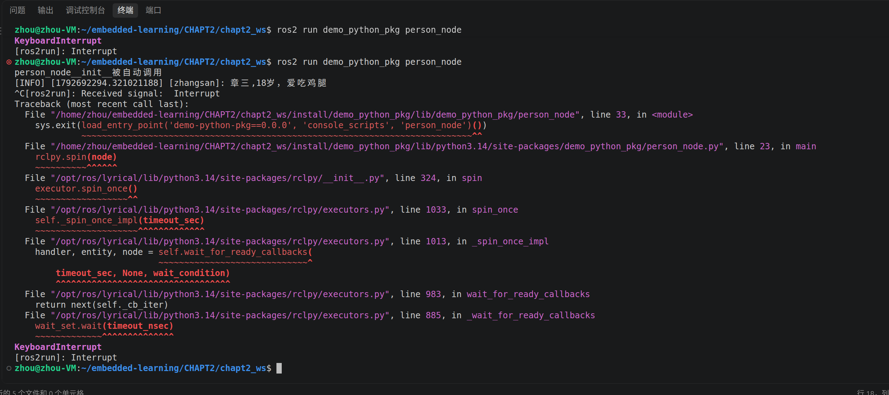

可选的整洁退出写法参见 [Lyrical 官方 Python 示例](https://github.com/ros2/examples/blob/lyrical/rclpy/topics/minimal_publisher/examples_rclpy_minimal_publisher/publisher_member_function.py)：使用 `with rclpy.init(...)` 并捕获 KeyboardInterrupt/ExternalShutdownException，可配合 finally 销毁节点。当前上传源码保持基础 init/spin/shutdown 结构，未将此建议写成已实现或已复测。

## 5. 引号、参数数量与作用域

| 现象 | 定位与修复 |
| --- | --- |
| `SyntaxError: unterminated string literal` | 姓名前的英文单引号遗漏，补齐成 `'章三'` |
| `NameError: food_name is not defined` | food_name 是 eat 的形参，不能直接在没有定义它的构造函数中使用；将食物相关逻辑放在 eat 中 |
| `missing ... argument: book` | 构造函数增加 food_name 后仍只传四个参数，书名被绑定给 food_name 而 book 缺失；最终食物由 eat 接收，构造函数只接收节点名、姓名、年龄、书名 |
| `AttributeError: ... has no attribute 'food'` | 调用 eat('面包') 不会自动创建 node.food；参数和对象属性是不同概念 |

<details>
<summary>查看引号、作用域、参数与属性错误的原始截图</summary>

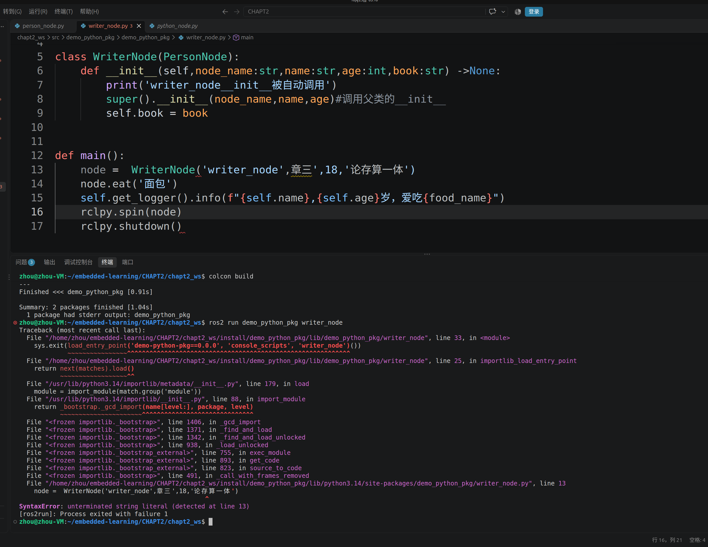

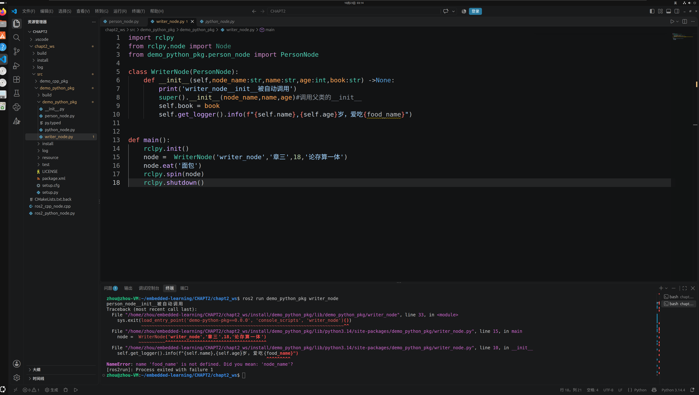

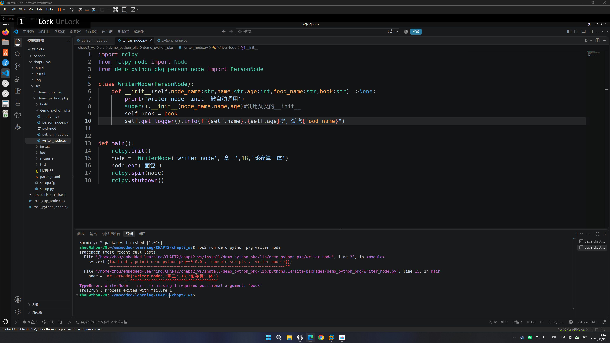

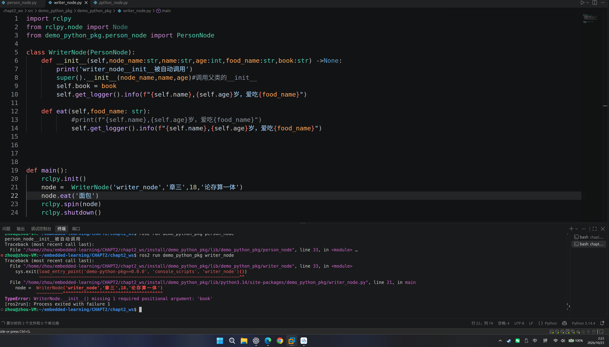

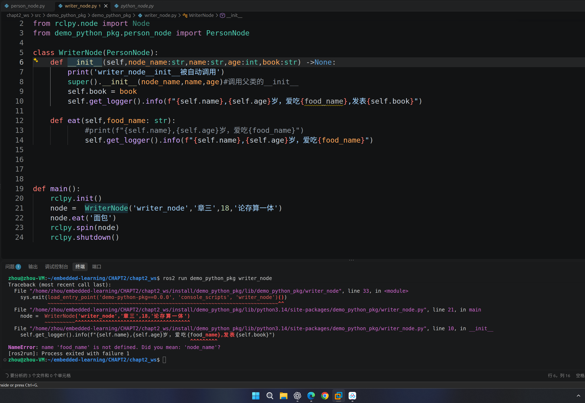

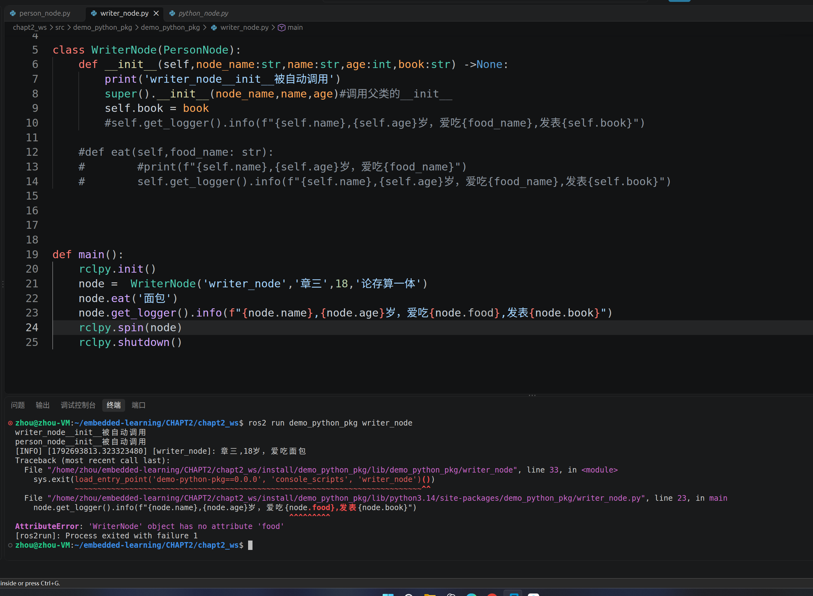

</details>

## 6. 重写 eat 与直接继承 eat

WriterNode 定义自己的 eat 时，`node.eat(...)` 会执行子类版本，可以把书名拼入同一条日志。这一重写版本已经有成功截图：

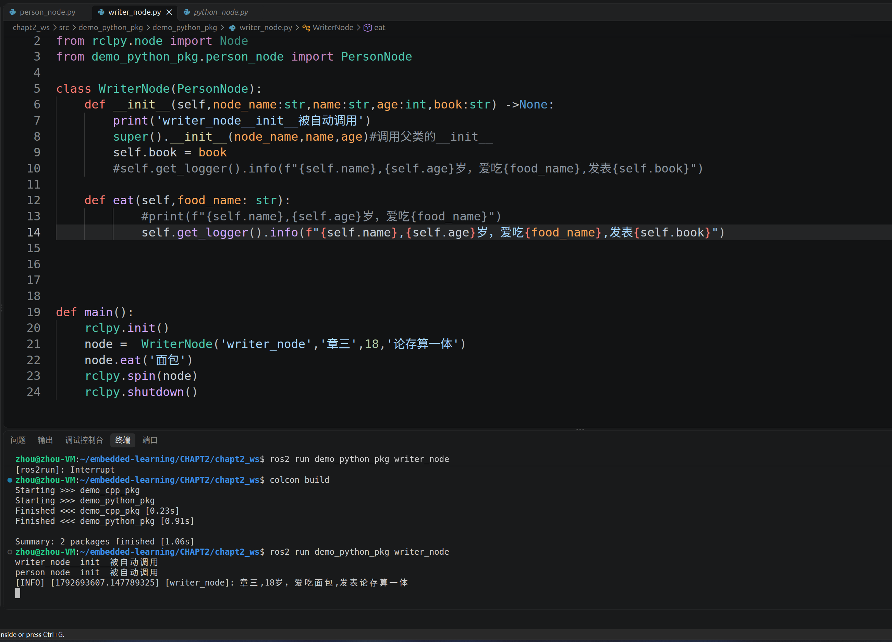

随后按学习者要求不再重写 eat，直接继承父类方法。父类 eat 当时立即打日志，main 又打作品日志，因此正常运行但输出两条：

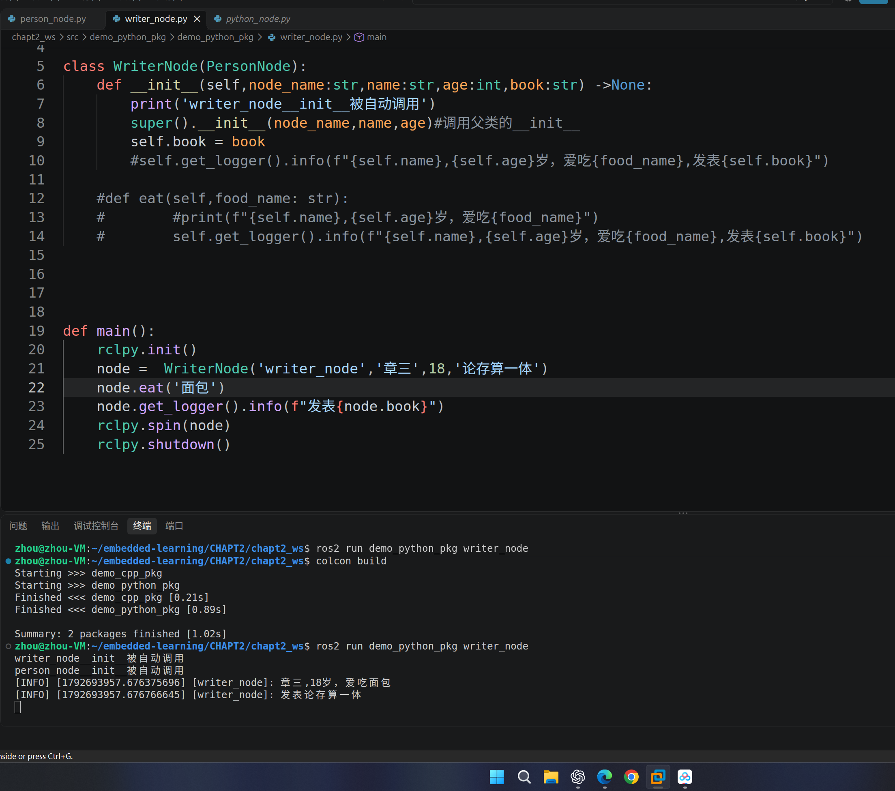

这张图对应本次提供的原始文件状态。已经输出的日志不能在后续调用中继续追加文字；要合成一次输出，需要在真正记录日志前先组合文本。

## 7. 当前归档版本：复用父类，只打一条完整日志

本次上传按最后确定的方案对原件做最小修改。PersonNode.eat 默认仍输出日志，同时增加可选开关并返回文本：

```python
def eat(self, food_name: str, log_output: bool = True) -> str:
    text = f"{self.name}，{self.age}岁，喜欢吃{food_name}"
    if log_output:
        self.get_logger().info(text)
    return text
```

WriterNode 不重写 eat，在 main 中组合书名后输出一次：

```python
text = node.eat('面包', log_output=False)
node.get_logger().info(f"{text}，发表《{node.book}》")
```

原练习中的名字为“章三”，本次保留原值。默认日志格式下预期为：

```text
[INFO] [时间戳] [writer_node]: 章三，18岁，喜欢吃面包，发表《论存算一体》
```

初始化中的调试 print 仍保留，因此“一条日志”指一条 INFO 消息，并非终端总共只显示一行。该复用版本尚无 Ubuntu 运行截图；本地检查仅验证 Python 语法与日志组合逻辑，不代替 ROS 2 集成测试。

## 复现与下一步

从仓库根目录进入 `CHAPT2/chapt2_ws`，加载 ROS 2 后构建，加载 install/setup.bash，再运行 `ros2 run demo_python_pkg person_node` 或 `ros2 run demo_python_pkg writer_node`。完整命令见 [本章入口](README.md)。

当前已归档 PersonNode/WriterNode 完整源码与前后截图。下一步在 Ubuntu 复测最终复用方案，再继续话题通信。参考：[Python 类与继承](https://docs.python.org/3.14/tutorial/classes.html)、[入口与包发现](TROUBLESHOOTING.md)。
