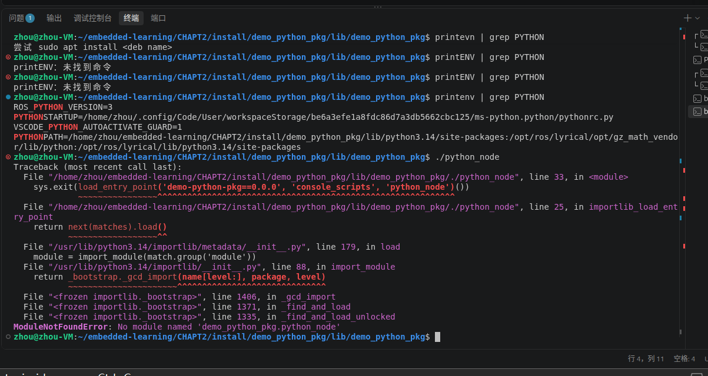
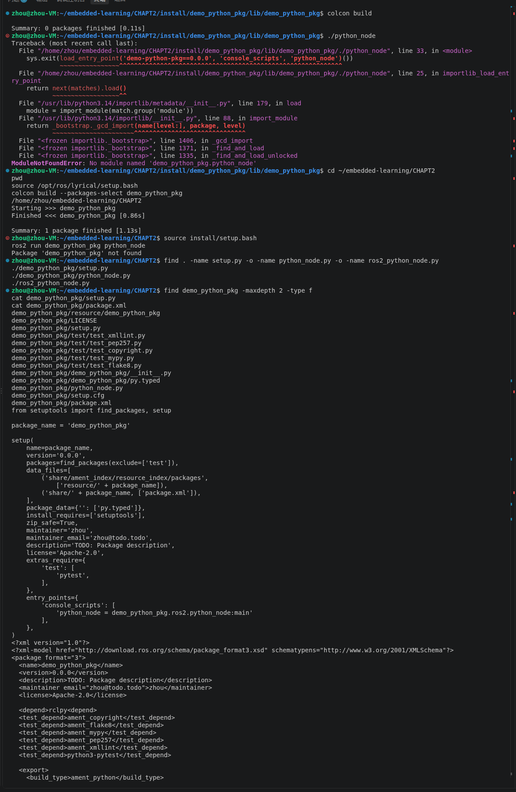
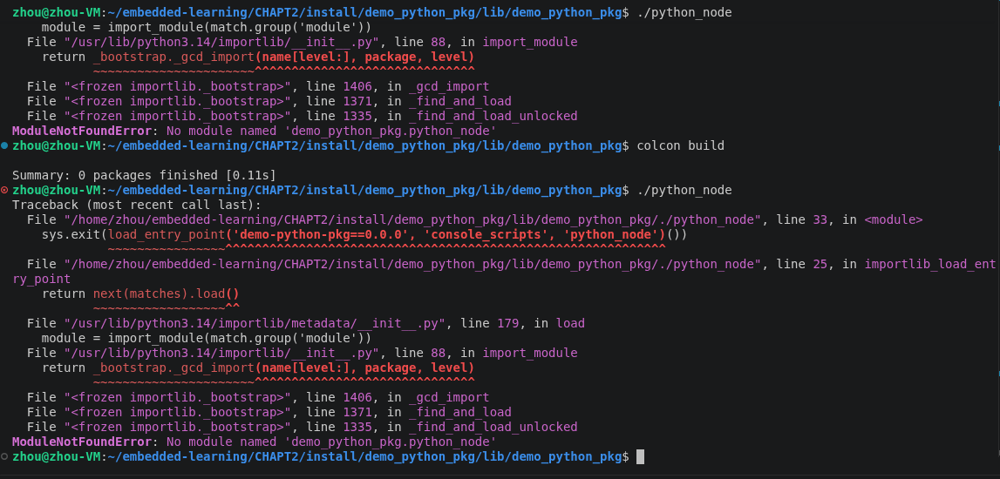
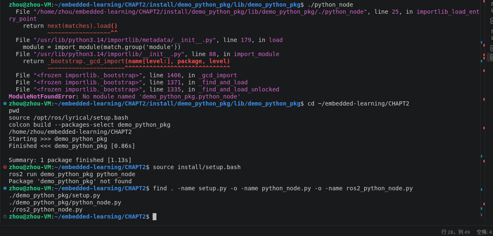
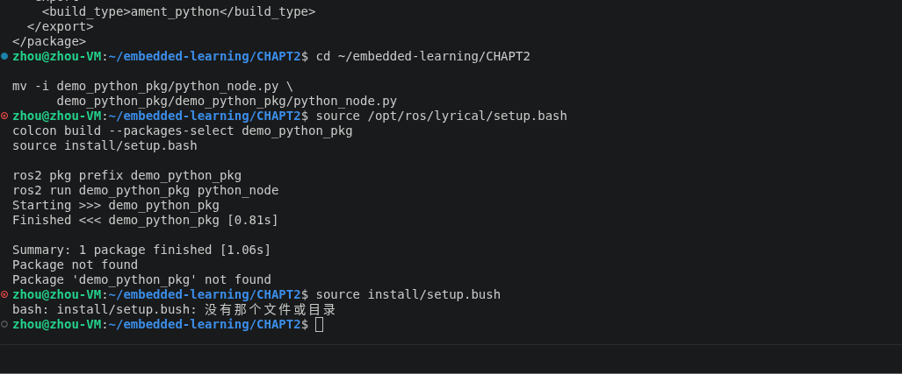
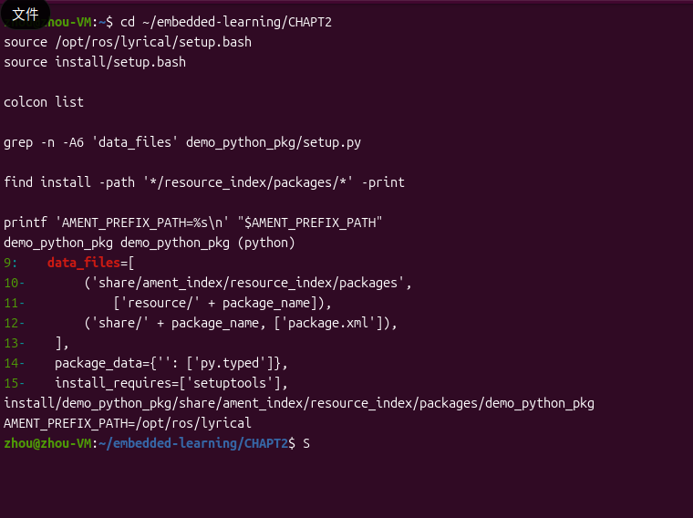
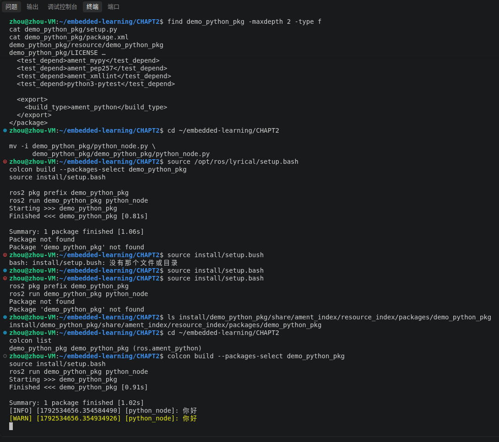
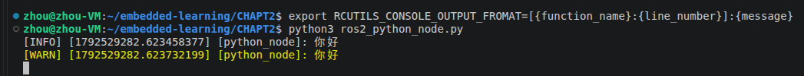
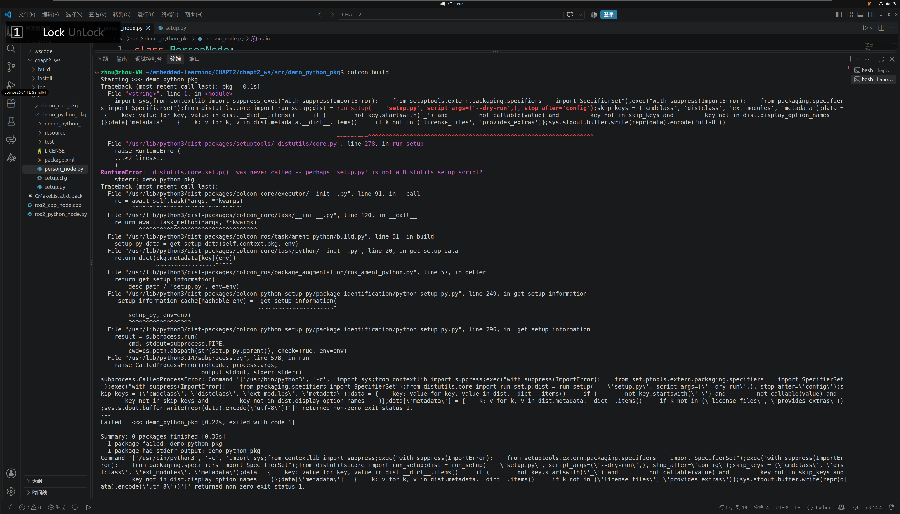
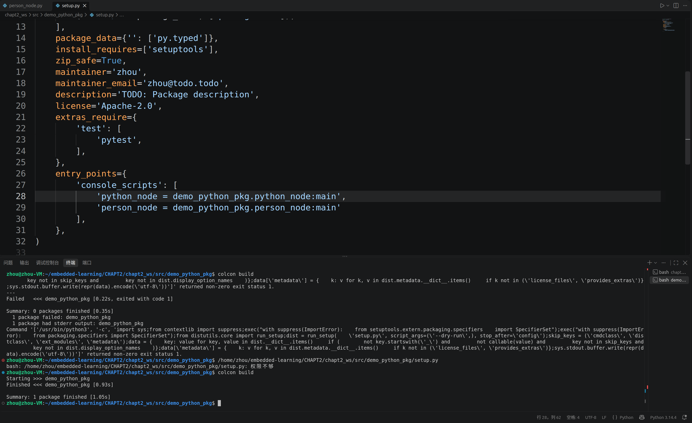

# 第二章 Python 排错记录：模块、功能包与入口配置

[本章入口](README.md) · [功能包源码](demo_python_pkg/) · [成功截图](images/python-node-success.png)

本页记录 Python 包排错。后续 C++ 包的命令拼写、Lyrical 依赖宏、安装关键字及运行成功记录见 [CPP_NODE.md](CPP_NODE.md)。

早期排查先修复源码位置与入口，再核对构建目录、安装索引和环境，最终通过修正 `package.xml` 的 XML 闭合标签恢复 ROS 2 包识别；当前上传的早期源码已包含这些修正。后续新工作空间中新增入口漏逗号的问题见第 7 节，以截图和配置片段归档，新版完整源码仍待同步。

## 1. 启动脚本存在，但 Python 模块找不到

**现象：** 在安装目录执行 `./python_node`，出现：

```text
ModuleNotFoundError: No module named 'demo_python_pkg.python_node'
```



检查文件后发现，`python_node.py` 曾位于外层功能包目录；`setup.py` 的入口还曾写为 `demo_python_pkg.ros2.python_node:main`，与实际模块结构不一致。



**修复：** 把节点放在内层 Python 包：

```text
demo_python_pkg/                       ← ROS 2 功能包目录
├── setup.py
├── setup.cfg
├── package.xml
├── resource/demo_python_pkg
└── demo_python_pkg/                   ← Python 可导入包
    ├── __init__.py
    ├── py.typed
    └── python_node.py
```

入口改为：

```python
'python_node = demo_python_pkg.python_node:main'
```

左侧是可执行入口名；右侧是 `模块:函数`。当前代码见 [setup.py](demo_python_pkg/setup.py) 和 [python_node.py](demo_python_pkg/demo_python_pkg/python_node.py)。应修改源码并重新构建，安装目录里的启动脚本由构建生成。

## 2. 在安装目录构建，发现 0 个包

**现象：** 当前目录为 `CHAPT2/install/demo_python_pkg/lib/demo_python_pkg`，执行 `colcon build`，得到 `Summary: 0 packages finished`。



**原因：** 构建起点位于生成的安装目录，该处没有需要构建的源码包。

**修复：** 返回工作空间根目录再构建。本章工作空间是 `CHAPT2`，包直接放在这个目录下：

```bash
cd ~/embedded-learning/CHAPT2
source /opt/ros/lyrical/setup.bash
colcon list
colcon build --packages-select demo_python_pkg
source install/setup.bash
```

克隆本仓库时，将第一行改为自己实际的仓库路径下的 `CHAPT2`。后续运行使用 `ros2 run demo_python_pkg python_node`。



这一步的 `1 package finished` 只说明构建任务完成，之后仍需验证 ROS 包发现和 Python 导入。

## 3. 核对 ament 索引与环境加载脚本

**索引拼写：** 历史配置中曾写成 `share/amet_index/resource_index/packages`，`ament` 少了 `n`。修正为：

```python
data_files=[
    ('share/ament_index/resource_index/packages',
     ['resource/' + package_name]),
    ('share/' + package_name, ['package.xml']),
],
```

**脚本拼写：** 一次手动重试还把 `setup.bash` 写成了 `setup.bush`，所以出现“没有那个文件或目录”。



应在 `CHAPT2` 执行 `source install/setup.bash`。这个拼写错误解释了该次加载失败，但不能解释先前正确加载 `.bash` 后仍找不到包的现象。

## 4. 注册文件存在，为什么仍找不到包

进一步收集的证据：

```bash
colcon list
grep -n -A6 'data_files' demo_python_pkg/setup.py
find install -path '*/resource_index/packages/*' -print
printf 'AMENT_PREFIX_PATH=%s\n' "$AMENT_PREFIX_PATH"
```



截图显示：

- 包标记文件已存在于正确的 `ament_index/resource_index/packages` 目录。
- `colcon list` 类型仍为普通 `(python)`，未识别成 `(ros.ament_python)`。
- 加载后 `AMENT_PREFIX_PATH` 只有 `/opt/ros/lyrical`，未包含本章包的安装前缀。

因此继续检查包清单，而不是仅凭标记文件存在就判断修复完成。

## 5. 关键修复：闭合 `package.xml` 的依赖标签

学习者发现依赖写成了：

```xml
<depend>rclpy<depend>
```

这不是合法闭合的 XML。修正为：

```xml
<depend>rclpy</depend>
```

同时保留正确的构建类型：

```xml
<export>
  <build_type>ament_python</build_type>
</export>
```

原始配置全图见[配置检查截图](images/python-package-config.png)，当前修正版见 [package.xml](demo_python_pkg/package.xml)。修改并保存后，重新运行：

```bash
cd ~/embedded-learning/CHAPT2
source /opt/ros/lyrical/setup.bash
colcon list
colcon build --packages-select demo_python_pkg
source install/setup.bash
ros2 pkg prefix demo_python_pkg
ros2 run demo_python_pkg python_node
```

最终截图中，包类型恢复为 `(ros.ament_python)`，构建显示 `1 package finished`，节点成功打印两条“你好”日志。



`colcon-ros` 识别 ROS 包时会解析 `package.xml`；清单解析失败可使 ROS 包识别失败，而普通 Python 包识别仍可能成功。此处结合错误标签、前后包类型和最终运行结果定位问题。曾考虑过扩展缺失的可能性，但没有安装扩展的修复证据，因此不把它记为本次原因或已执行步骤。

实现参考：[colcon-ros 包识别](https://github.com/colcon/colcon-ros/blob/master/colcon_ros/package_identification/ros.py)、[ament_python 构建与环境钩子](https://github.com/colcon/colcon-ros/blob/master/colcon_ros/task/ament_python/build.py)、[ROS 2 官方 Python 包配置示例](https://github.com/ros2/examples/blob/lyrical/rclpy/topics/minimal_publisher/setup.py)。

## 6. 日志格式没有变化，如何恢复默认

历史命令把变量写成了 `RCUTILS_CONSOLE_OUTPUT_FROMAT`，正确拼写是 `FORMAT`。



先按 `Ctrl+C` 停止节点，在同一终端中设置并重新运行：

```bash
export RCUTILS_CONSOLE_OUTPUT_FORMAT='[{function_name}:{line_number}]:{message}'
ros2 run demo_python_pkg python_node
```

恢复默认格式：

```bash
unset RCUTILS_CONSOLE_OUTPUT_FORMAT
ros2 run demo_python_pkg python_node
```

可额外用 `unset RCUTILS_CONSOLE_OUTPUT_FROMAT` 清除误写的变量。若将设置写入了 `~/.bashrc`，也需修改对应行；当前没有证据表明已写入。格式变量参考 [rcutils 日志实现](https://github.com/ros2/rcutils/blob/lyrical/src/logging.c)。

## 7. 新增 `person_node` 入口时漏写逗号

### 现象与定位

在后续新工作空间 `CHAPT2/chapt2_ws` 中，给 `demo_python_pkg` 添加 `person_node` 入口后构建失败。报错包含：

```text
RuntimeError: 'distutils.core.setup()' was never called --
perhaps 'setup.py' is not a Distutils setup script?
```



学习者定位为 `console_scripts` 两条入口之间漏了逗号，补上后再次构建，终端显示 `Finished <<< demo_python_pkg` 和 `Summary: 1 package finished`。



修正后的关键片段：

```python
entry_points={
    'console_scripts': [
        'python_node = demo_python_pkg.python_node:main',
        'person_node = demo_python_pkg.person_node:main'
    ],
},
```

第一条入口末尾的逗号用于分隔两个列表项。最后一项后面的尾逗号可选，也可保留以便继续新增入口。

### 为什么漏逗号不一定出现 SyntaxError

Python 会拼接相邻的字符串字面量，即使它们跨行放在同一个列表里。例如：

```python
['python_node = demo_python_pkg.python_node:main'
 'person_node = demo_python_pkg.person_node:main']
```

这是含一个长字符串的列表，不是两个入口。因而语法解析可能通过，但入口字符串的内容已经错误。参见 [Python 字符串字面量拼接](https://docs.python.org/3.14/reference/expressions.html#string-literal-concatenation)和 [setuptools console_scripts 配置](https://setuptools.pypa.io/en/latest/userguide/entry_point.html#console-scripts)。

`setup() was never called` 是本次构建日志中的外层提示，不能仅凭它断言 `setup.py` 一定缺少 `setup(...)` 语句；应结合完整配置检查。本轮依据学习者定位、补逗号的截图和随后构建成功的结果记录原因，没有将早期“调用缺失”的排查假设写成结论。

### “权限不够”来自直接执行文件路径

修复截图的终端历史还显示，曾直接输入 `setup.py` 的完整路径，Bash 随后报“权限不够”。这是尝试将该文件作为命令执行时的提示，不能据此判断文件无法读取、无法保存或所有者错误。

查看内容应使用：

```bash
cd ~/embedded-learning/CHAPT2/chapt2_ws
nl -ba src/demo_python_pkg/setup.py
```

读取文件不要求它具有可执行权限。本轮没有足够证据将所有权修改或权限修改记为修复步骤。

### 后续按工作空间根目录复测

这轮截图的成功构建是在 `chapt2_ws/src/demo_python_pkg` 包目录内执行的，该处构建产物与工作空间根目录下的产物位置不同。后续统一回到 `chapt2_ws` 构建和加载环境：

```bash
cd ~/embedded-learning/CHAPT2/chapt2_ws
source /opt/ros/lyrical/setup.bash
colcon build --packages-select demo_python_pkg
source install/setup.bash
ros2 run demo_python_pkg person_node
```

以上根目录复测和 `person_node` 启动仍待记录实际结果。本轮确认的是补逗号后构建成功，尚未取得该新增入口的运行输出。若入口为 `demo_python_pkg.person_node:main`，对应源码应位于内层 `src/demo_python_pkg/demo_python_pkg/person_node.py`，并提供 `main()`。

当前仓库保存早期功能包源码；新工作空间中新增的 `person_node.py` 和完整配置尚未同步。本节保留截图与关键片段，不将其作为完整源码副本。

## 结果与尚未覆盖的内容

`INFO` 和黄色 `WARN` 都来自本章源码主动输出。节点随后进入 `rclpy.spin(node)`，等待事件；它没有定时器，不会周期性打印。按 `Ctrl+C` 可停止。

本次已验证 Python 功能包在学习者 Ubuntu 环境中启动成功，证据为上方真实终端截图。后续 C++ 包也已构建运行成功，见 [C++ 排错与验收](CPP_NODE.md)。上传源码以实际收到的当前文件为准，排错截图保留修复前后状态；新 C++ 包完整源码仍待同步。
