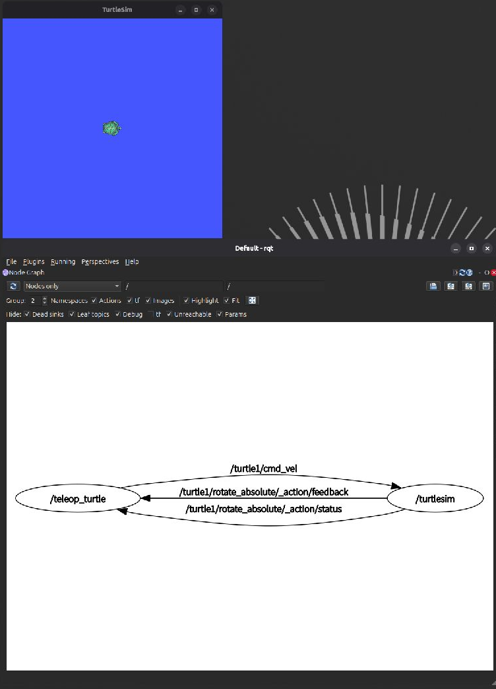

# 嵌入式与机器人 Linux 学习实验室

记录 ROS 2、C++ 与 Linux 的学习实践，逐步积累机器人软件与嵌入式项目。每次学习保留笔记、关键命令、实际结果和问题分析，让过程可以回顾、实验可以复现。

**当前主线：ROS 2 Lyrical + C++。** 跟随鱼香 ROS 机器人《ROS 2机器人开发从入门到实践》，从 **1.3「运行你的第一个机器人」** 的小海龟实验开始。

[课程视频](https://www.bilibili.com/video/BV1iE421w7d5/) · [ROS 2 学习入口](docs/ros2/README.md) · [最新记录：2026-10-21](docs/ros2/2026-10-21.md)

## 学习导航

| 内容 | 入口 |
| --- | --- |
| 小海龟、节点、包、话题与消息 | [第一课笔记与练习](docs/ros2/lesson-01-turtlesim.md) |
| 当前学习进度与 Ubuntu 截图 | [2026-10-21 学习日志](docs/ros2/2026-10-21.md) |
| ROS 2 与 C++ 后续安排 | [ROS 2 学习路线](docs/ros2/roadmap.md) |
| 每次学习的记录格式 | [日志模板](docs/ros2/daily-log-template.md) |
| Ubuntu 与 VMware 环境配置 | [Linux 环境说明](docs/linux-setup.md) |
| 各阶段进度与实际证据 | [总体进度](docs/progress.md) |

## 当前进度

更新日期：**2026-10-21**。

- [x] 在现有 VMware Ubuntu 环境中开始 ROS 2 学习。
- [x] 从终端画面确认 `ROS_DISTRO=lyrical`。
- [x] 看到 TurtleSim 窗口，以及 `/teleop_turtle`、`/turtlesim` 的节点关系图。
- [x] 归档 Ubuntu 截图、第一课笔记、学习路线和日志模板。
- [ ] 记录方向键控制海龟的实际运动与 `/turtle1/cmd_vel` 消息。
- [ ] 用自己的话解释包、可执行程序、节点、话题与消息类型。
- [ ] 创建并编译第一个 C++ ROS 2 功能包。

启动画面与节点图见当日日志；运动、消息输出和后续程序按实际实验结果继续补充。

## 学习环境

| 项目 | 当前环境 | 记录来源 |
| --- | --- | --- |
| 操作系统 | Ubuntu 26.04.1 LTS，x86_64 | 此前学习者报告 |
| 运行方式 | VMware 虚拟机 | Ubuntu 学习截图 |
| ROS 2 | Lyrical | 终端 `printenv ROS_DISTRO` 输出 |
| 编程主线 | C++；按课程需要阅读 Python 示例 | 当前学习安排 |
| 已记录工具 | Git 2.53.0、Python 3.14.4、VS Code 1.142.0 | 此前学习者报告 |

编译器、构建工具和依赖的实际版本，在进入 C++ 功能包练习时补充。

## 复现小海龟实验

以下命令在已经安装 ROS 2 Lyrical 与相关示例包的 **Ubuntu Bash 终端**中执行。每个终端先加载环境；已经运行的节点可以继续使用。

**终端 A：启动仿真。**

```bash
source /opt/ros/lyrical/setup.bash
ros2 run turtlesim turtlesim_node
```

**终端 B：启动键盘控制。**

```bash
source /opt/ros/lyrical/setup.bash
ros2 run turtlesim turtle_teleop_key
```

将焦点放在终端 B，使用方向键控制海龟。

**终端 C：查看节点、话题和速度消息。**

```bash
source /opt/ros/lyrical/setup.bash
ros2 node list
ros2 topic list -t
ros2 topic info /turtle1/cmd_vel
ros2 topic echo /turtle1/cmd_vel
```

保持终端 C 观察消息，切回终端 B 按方向键，对照海龟运动与 `linear.x`、`angular.z` 的变化。按 `Ctrl+C` 结束消息观察。需要查看节点图时，可在另一个已加载环境的终端执行 `ros2 run rqt_graph rqt_graph`。

```text
键盘 → /teleop_turtle → /turtle1/cmd_vel → /turtlesim → 海龟运动
```

`/teleop_turtle` 发布速度指令，`/turtlesim` 订阅这些指令；消息类型为 `geometry_msgs/msg/Twist`。完整的环境检查、位姿观察和验收步骤见[第一课](docs/ros2/lesson-01-turtlesim.md)。

**版本提醒：** 当前环境文件为 `/opt/ros/lyrical/setup.bash`。旧教程中的 `/opt/ros/humble/setup.bash` 与当前环境不同，相关报错已记入[当日日志](docs/ros2/2026-10-21.md#发现的版本问题)。

## Ubuntu 学习截图

2026-10-21 保存的小海龟与节点图：



[查看完整 Ubuntu 截图](docs/ros2/2026-10-21-ubuntu.png) · [查看实验记录与版本问题](docs/ros2/2026-10-21.md)

## 接下来的学习目标

1. 完成视频 1.3 的节点与话题练习，保存实际消息和自己的解释。
2. 按需要复习 [1.4.5「环境变量」](https://www.bilibili.com/video/BV1pm42137bR/)。
3. 学习 [2.1.2「编写你的第一个节点（C++ 示例）」](https://www.bilibili.com/video/BV1FH4y1c7Px/)，进入 `rclcpp`、功能包、工作空间和构建流程。
4. 用自己编写的 C++ 节点发布速度、读取海龟位姿，再学习服务、参数与 Launch。

具体阶段与验收条件见 [ROS 2 学习路线](docs/ros2/roadmap.md)，按实践进展调整。

## 嵌入式与机器人长期计划

| 方向 | 计划内容 | 当前状态 |
| --- | --- | --- |
| C/C++ 与 Linux 工程基础 | 编译、GDB 调试、数据结构、模块化与 CMake | 按学习需要补充实践 |
| 设备通信协议 | C 解析器、虚拟设备、Python 测试与错误恢复 | 待开始 |
| FreeRTOS | Linux/POSIX 示例、任务、队列与同步 | 待开始 |
| 电机与双轮底盘仿真 | 速度闭环、差动运动学、轨迹与超时停车 | 待开始 |
| ROS 2 机器人仿真 | 当前基础通信，后续 TF、RViz、Gazebo 与导航 | 基础入门进行中；后续项目待开始 |

保留[原 16 周路线](docs/roadmap.md)与[原始路线资料](docs/reference/original-roadmap.md)作为参考；ROS 2 学习已提前开始，后续按实际进度安排。

## 记录方式与参考

每次围绕一个小目标，记录「视频章节 → 操作命令 → 实际结果 → 问题与处理 → 自己的理解 → 下一步」，使用[日志模板](docs/ros2/daily-log-template.md)追加记录。源码、测试和运行成果在实际完成后归档。

- [鱼香 ROS 机器人：当前学习视频](https://www.bilibili.com/video/BV1iE421w7d5/)
- [ROS 2 Lyrical 官方文档](https://docs.ros.org/en/lyrical/)
- [官方 TurtleSim 教程源文件](https://github.com/ros2/ros2_documentation/blob/lyrical/source/Get-Started/Introducing-Turtlesim/Introducing-Turtlesim.rst)

笔记与操作说明由 AI 辅助整理，学习者的实际操作、独立修改和理解持续补充。截图来自真实 Ubuntu 虚拟机，第三方课程与文档保留原作者链接。
